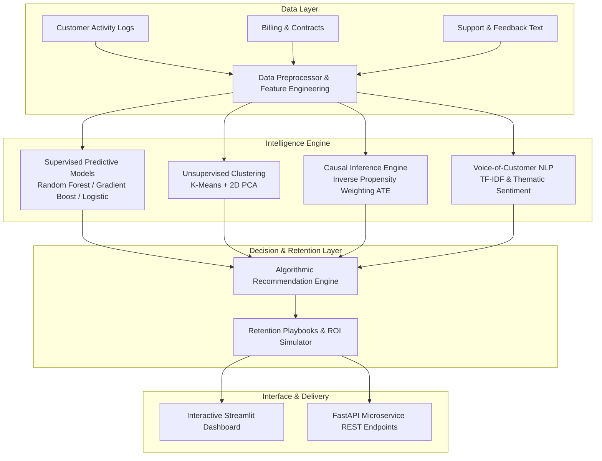

# RetainPulse AI: Customer Churn & Retention Intelligence Platform

[](https://www.python.org/)
[](https://opensource.org/licenses/MIT)
[](https://fastapi.tiangolo.com)
[](https://streamlit.io)
[](tests/)

---

## 📌 Problem Statement

Subscription-based and Software-as-a-Service (SaaS) businesses operate in an increasingly competitive environment where Customer Acquisition Costs (CAC) continue to surge. In this economic landscape, recurring revenue stability and Net Revenue Retention (NRR) dictate business survival. However, subscription companies face compounding churn challenges:

1. **Silent Customer Degradation**: Customers often disengage weeks or months before formal cancellation or renewal failure without submitting support tickets or complaints.
2. **Black-Box Predictive Gaps**: Conventional churn models output a single probability score without explaining **why** a specific customer is leaving or isolating actionable root causes versus spurious correlations.
3. **One-Size-Fits-All Retention Tactics**: Blanket discounts and generic outreach waste marketing budget, trigger margin erosion, and fail to address cohort-specific pain points (such as product bugs, support latency, or onboarding friction).
4. **Lack of Prescriptive ROI Estimation**: Customer Success and Growth teams lack data-driven tools to simulate the financial return (ARR protected vs. retention incentive cost) before deploying interventions.

**RetainPulse AI** addresses this problem by delivering an integrated, end-to-end intelligence platform that combines **behavioral telemetry feature engineering**, **predictive churn classification**, **unsupervised cohort segmentation**, **causal inference (Average Treatment Effects)**, **Voice-of-Customer NLP**, and an **algorithmic retention recommendation engine with ROI simulation**.

---

An enterprise-grade, AI-powered system designed for subscription businesses facing increasing churn rates. Built with causal ML diagnostics, predictive ensemble algorithms, unsupervised customer clustering, automated Voice-of-Customer NLP, and an algorithmic retention recommendation engine.

---

## 🌟 Executive Summary & Problem Context

For modern SaaS and subscription companies, customer acquisition costs (CAC) continue to climb. Losing customers ("churn") severely degrades Net Revenue Retention (NRR) and lifetime customer value (LTV). Most churn solutions rely solely on black-box probabilities without explaining **why** customers leave or **which specific intervention** will retain them profitably.

**RetainPulse AI solves this by executing a 5-step intelligence loop:**
1. **Behavioral Pattern Detection**: Flags subtle leading indicators (usage trend shifts, inactivity spikes, support friction).
2. **Predictive Churn Scoring**: Evaluates churn risk via an ensemble with full local interpretability.
3. **Cohort Segmentation**: Uses K-Means and 2D PCA to cluster customers into behavioral archetypes.
4. **Causal Root-Cause Diagnostics**: Leverages Propensity Score Weighting (IPW) to isolate Average Treatment Effects (ATE) of business levers.
5. **Algorithmic Retention Engine**: Generates tailored communication templates, incentive offers, and product playbooks with ROI projections.

---

## 🏗️ High-Level System Architecture



---

## 🚀 Core Features

- **Multi-Model Predictive Benchmarking**: Evaluates Random Forest, Gradient Boosting, and Logistic Regression with ROC-AUC, PR-AUC, F1-score, and precision/recall tradeoffs.
- **Explainable AI (XAI)**: Generates both global feature rankings and individual local feature impacts (distinguishing Risk Drivers from Retention Anchors).
- **Behavioral Cohort Clustering**: Classifies accounts into 4 core archetypes:
  - *Disengaged High-Touch Users* (Critical Risk)
  - *Healthy Power Accounts* (Low Risk / Loyal)
  - *Passive Under-Utilizers* (High Risk / Silent)
  - *Price & Billing Sensitive* (Moderate-to-High Risk)
- **Causal Impact Analysis (Average Treatment Effect)**: Quantifies true causal effects of contract commitments, price increases, support resolution delays, and auto-renew status.
- **Voice-of-Customer (VoC) NLP**: Sentiment analysis and topic categorization on customer complaints and qualitative feedback.
- **Algorithmic Retention Playbooks**: Produces targeted communication scripts, financial incentive offers (discounts, billing credits, SLA guarantees), and ROI estimations.
- **Interactive "What-If" Scenario Simulator**: Interactive business planner assessing the financial impact and ARR recovery from custom retention campaigns.
- **Production-Ready REST API**: FastAPI server with automated schema validation and sub-millisecond response times.

---

## 📂 Project Repository Structure

```
Customer Churn & Retention Intelligence/
├── app/
│   └── streamlit_app.py           # Interactive Streamlit dashboard UI
├── data/
│   └── customer_churn_data.csv    # Synthetic SaaS customer dataset (3,000 records)
├── docs/
│   ├── API_GUIDE.md               # REST API documentation & curl examples
│   ├── SETUP_AND_RUN.md           # Step-by-step installation & deployment guide
│   ├── TECHNICAL_DEEP_DIVE.md     # In-depth algorithmic & mathematical breakdown
│   └── USE_CASES.md               # Enterprise business scenarios & playbooks
├── src/
│   ├── __init__.py
│   ├── api.py                     # Production FastAPI microservice
│   ├── pipeline.py                # Unified orchestrator coordinating all modules
│   ├── causal/
│   │   ├── __init__.py
│   │   └── causal_analyzer.py     # Causal IPW inference & feedback NLP
│   ├── clustering/
│   │   ├── __init__.py
│   │   └── segmentation.py        # K-Means clustering & PCA projections
│   ├── data/
│   │   ├── __init__.py
│   │   ├── generator.py           # Synthetic dataset generator
│   │   └── preprocessor.py        # Feature engineering, scaling & encoding
│   ├── models/
│   │   ├── __init__.py
│   │   ├── churn_predictor.py     # Multi-algorithm classification engine
│   │   ├── churn_models.joblib    # Serialized model weights
│   │   ├── preprocessor.joblib    # Fitted transformer pipeline
│   │   └── segmenter.joblib       # Fitted clustering model
│   └── retention/
│       ├── __init__.py
│       └── recommendation_engine.py # Algorithmic recommendation engine & ROI
├── tests/
│   └── test_pipeline.py           # Pytest test suite (8 test cases)
├── requirements.txt               # Pinned Python package dependencies
├── LICENSE                        # MIT License
└── README.md                      # Comprehensive project guide
```

---

## 🧠 Algorithm & Technical Overview

RetainPulse AI combines five interlinked algorithmic components across predictive machine learning, unsupervised clustering, causal inference, natural language processing, and decision optimization:

```
[Customer Telemetry & Billing]
              │
              ▼
   ┌────────────────────────────────────────────────────────┐
   │ 1. Feature Engineering & Ratio Derivations             │
   │    • Inactivity Ratio = min(days_since_login / 30, 3)   │
   │    • Support Intensity = tickets × (lag_hours / 24)    │
   │    • Engagement Composite = active_ratio × adoption    │
   └────────────────────────────────────────────────────────┘
              │
      ┌───────┴───────────────────────┬───────────────────────┐
      ▼                               ▼                       ▼
┌─────────────────────────┐  ┌───────────────────────┐  ┌─────────────────────────┐
│ 2. Predictive Churn     │  │ 3. Unsupervised       │  │ 4. Causal Inference &   │
│    Classification       │  │    Clustering (K-Means)│  │    Feedback NLP (IPW)   │
│    • Logistic Reg.      │  │    • 4 Cohort Profiles │  │    • Inverse Propensity │
│    • Random Forest      │  │    • 2D PCA Dimensional│  │      Score Weighting    │
│    • Gradient Boosting  │  │      Projection        │  │    • TF-IDF Sentiment   │
│    • Local Feature XAI  │  │                        │  │      Pain Point Tagging │
└─────────────────────────┘  └───────────────────────┘  └─────────────────────────┘
      │                               │                       │
      └───────┬───────────────────────┴───────────────────────┘
              ▼
   ┌────────────────────────────────────────────────────────┐
   │ 5. Algorithmic Retention Engine & ROI Optimizer        │
   │    • Risk Tiering (Severe Emergency to Healthy)        │
   │    • Actionable Multi-Channel Playbooks & Incentives   │
   │    • Value-at-Risk & Expected Net ROI Formulation      │
   └────────────────────────────────────────────────────────┘
```

### 1. Feature Engineering & Behavioral Derivations (`src/data/preprocessor.py`)
Static data points are enriched into dynamic behavioral indicators:
- **Inactivity Ratio**: $\text{Inactivity Ratio} = \min\left(\frac{\text{days\_since\_last\_login}}{30.0},\, 3.0\right)$
- **Support Intensity**: $\text{Support Intensity} = \text{tickets\_count} \times \left(\frac{\text{resolution\_lag\_hours}}{24.0}\right)$
- **Unit Cost Efficiency**: $\text{Charge per Active Day} = \frac{\text{monthly\_charges}}{\max(\text{monthly\_active\_days},\, 1.0)}$
- **Engagement Composite**: Measures the product adoption trajectory scaled by recent activity momentum.

### 2. Predictive Classification & Local Interpretability (`src/models/churn_predictor.py`)
- **Multi-Model Suite**: Evaluates and benchmarks **L2-Regularized Logistic Regression**, **Random Forest** (150 trees), and **Gradient Boosting** (deviance minimization).
- **Evaluation Criteria**: Prioritizes **ROC-AUC** (discrimination threshold) and **PR-AUC** (precision/recall trade-off under churn class imbalance) rather than raw accuracy.
- **Explainable AI (XAI)**: Generates global feature importance rankings as well as instance-level feature attributions distinguishing **Risk Drivers** from **Retention Anchors**.

### 3. Unsupervised Behavioral Segmentation (`src/clustering/segmentation.py`)
- **K-Means Clustering**: Groups normalized customer records into 4 operational cohorts ($k=4$):
  - *Disengaged High-Touch Users* (Critical Risk)
  - *Healthy Power Accounts* (Low Risk / Loyal)
  - *Passive Under-Utilizers* (High Risk / Silent)
  - *Price & Billing Sensitive* (Moderate-to-High Risk)
- **Principal Component Analysis (PCA)**: Projects the 24-dimensional feature space onto the top 2 orthogonal principal components for intuitive 2D cluster visualization.

### 4. Causal Root-Cause Inference & NLP (`src/causal/causal_analyzer.py`)
- **Inverse Propensity Score Weighting (IPW)**: Observational correlation is separated from causality. Using propensity models $e(\mathbf{X}) = P(T=1 \mid \mathbf{X})$, the engine calculates the **Average Treatment Effect (ATE)**:
  $$\text{ATE} = \mathbb{E}[Y^{(1)}] - \mathbb{E}[Y^{(0)}] = \frac{1}{\sum w_1} \sum_{i: T_i=1} w_{1,i} Y_i - \frac{1}{\sum w_0} \sum_{i: T_i=0} w_{0,i} Y_i$$
  Isolates the causal impact of annual contract lock-ins ($\text{ATE} \approx -22.1\%$), price increases ($\text{ATE} \approx +8.4\%$), slow support resolution ($\text{ATE} \approx +7.7\%$), and auto-renew status ($\text{ATE} \approx -27.1\%$).
- **Voice-of-Customer NLP**: Lexicon-informed TF-IDF vectorization and polarity scoring categorize verbatim customer tickets and feedback into pain-point domains (*Pricing*, *Support Latency*, *Bugs*, *Missing Features*).

### 5. Algorithmic Retention Playbook & ROI Optimization (`src/retention/recommendation_engine.py`)
- **Value-at-Risk ($VaR$)**: Calculates annualized financial exposure:
  $$VaR = \text{Monthly Charges} \times 12 \times P(\text{churn})$$
- **Net Program ROI**: Synthesizes custom retention tactics (e.g., annual contract switch discounts, auto-pay incentives, proactive SLA support guarantees) and projects expected return:
  $$\text{Expected Net ROI} = \frac{\mathbb{E}[\text{Saved ARR}] - \sum \text{Incentive Cost}}{\max(\sum \text{Incentive Cost},\, 1.0)}$$

---

## ⚡ Installation & Quickstart

### Prerequisites
- Python 3.10+ (tested on Python 3.11.8)
- pip package manager

### 1. Clone the Repository & Setup Virtual Environment
```bash
git clone https://github.com/your-username/customer-churn-retention-intelligence.git
cd "customer-churn-retention-intelligence"

python -m venv venv
# On Windows:
.\venv\Scripts\activate
# On Linux/macOS:
source venv/bin/activate
```

### 2. Install Dependencies
```bash
pip install -r requirements.txt
```

### 3. Generate Data & Train Models
```bash
# Generate synthetic subscription data
python src/data/generator.py

# Train predictive models & preprocessors
python -m src.models.churn_predictor

# Train behavioral clustering model
python -m src.clustering.segmentation
```

### 4. Run the Pytest Test Suite
```bash
pytest tests/
```

### 5. Launch the Streamlit Interactive Dashboard
```bash
streamlit run app/streamlit_app.py
```
*Access the UI at `http://localhost:8501`.*

### 6. Launch the Production FastAPI Service
```bash
uvicorn src.api:app --host 0.0.0.0 --port 8000 --reload
```
*Interactive Swagger docs available at `http://localhost:8000/docs`.*

---

## 📊 Data Requirements & Schema

The pipeline expects tabular data containing customer telemetry, billing, and interaction metrics:

| Column Name | Type | Description |
|---|---|---|
| `customer_id` | String | Unique account identifier (e.g., `CUST-10492`) |
| `subscription_plan` | String | Tier (`Starter`, `Professional`, `Enterprise`) |
| `contract_type` | String | Duration (`Monthly`, `Annual`, `Two-Year`) |
| `billing_method` | String | Payment method (`Credit Card`, `ACH`, `Invoice`) |
| `auto_renew` | Integer | Binary renewal status (1 = Active, 0 = Disabled) |
| `tenure_months` | Integer | Account age in months |
| `monthly_charges` | Float | Recurring monthly cost in USD |
| `team_size` | Integer | Seat count assigned to account |
| `monthly_active_days` | Float | Days logged in over the past 30 days |
| `usage_trend_30d` | Float | Ratio of recent usage vs prior baseline |
| `days_since_last_login`| Integer | Inactivity tracker in days |
| `feature_adoption_rate`| Float | Percentage of key core features utilized (0.0 to 1.0) |
| `support_tickets_count`| Integer | Number of tickets filed in current cycle |
| `avg_ticket_resolution_hours`| Float | Support responsiveness metric in hours |
| `payment_failures_past_6m` | Integer | Involuntary billing decline count |
| `recent_price_increase` | Integer | Flag indicating fee update (1 = Yes, 0 = No) |
| `nps_score` | Integer | Customer Net Promoter Score (0 to 10) |
| `customer_feedback` | String | Qualitative customer text feedback / ticket comments |

---

## 🤝 Contribution Guidelines

We welcome community contributions:
1. Fork the Project repository.
2. Create your Feature Branch (`git checkout -b feature/AdvancedSurvivalAnalysis`).
3. Commit your Changes (`git commit -m 'Add Kaplan-Meier survival curves'`).
4. Ensure all unit tests pass (`pytest tests/`).
5. Push to the Branch (`git push origin feature/AdvancedSurvivalAnalysis`).
6. Open a Pull Request.

---

## 📄 License

Distributed under the MIT License. See [LICENSE](LICENSE) for more details.

